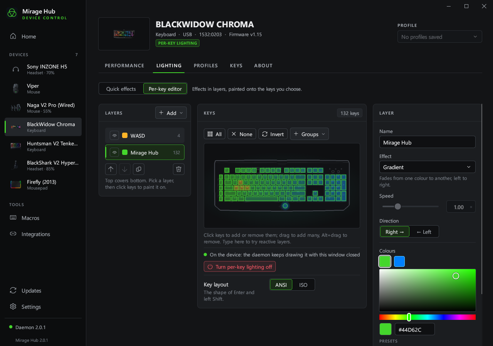
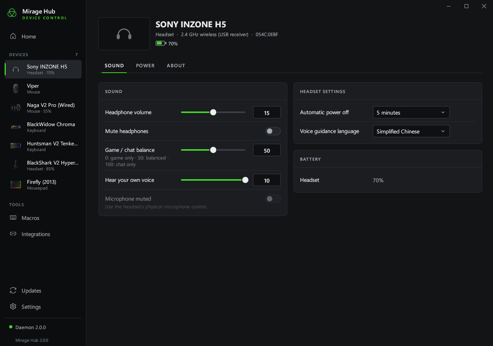

# Mirage Hub

[简体中文](README.zh-CN.md) · English

Control Razer peripherals and Sony INZONE headsets on Windows 10 / 11 with one native Rust application and background service. Formerly RsRazer.

No Synapse, custom kernel driver or Python runtime is required.

[](https://github.com/imacte/MirageHub/actions/workflows/ci.yml)
[](LICENSE)



## Download

Download **[mirage-hub-setup.exe](https://github.com/imacte/MirageHub/releases/latest/download/mirage-hub-setup.exe)** from [Releases](https://github.com/imacte/MirageHub/releases).
It contains the application, native daemon and 32/64-bit Chroma SDK DLLs.
The installer works per user and supports repair and removal.
The installer includes English, Simplified Chinese and Russian.

The tray and UI run in separate processes. Closing the window saves the current page and editor drafts,
then exits the UI process to release its memory. Device communication, automatic profiles and update
downloads continue in the tray; click its icon to reopen the window.

| File | Purpose |
|---|---|
| `mirage-hub-setup.exe` | Complete installer; the recommended download |
| `mirage-hub.exe` | Main application; needs `mirage-hub-daemon.exe` beside it when used without the installer |
| `mirage-hub-daemon.exe` | Native background service and command line |
| `mirage-hub-classic.exe` | Classic control panel with the daemon embedded |

Native release builds include the C runtime. Close Synapse before controlling the same devices.
Settings, profiles, macros and logs are stored in `%LOCALAPPDATA%\mirage-hub`.
Mirage Hub does not automatically read or migrate data from `%LOCALAPPDATA%\openrazer-win`.

## Sony INZONE

INZONE support is ported from [OpenInzone](https://github.com/penguinwokrs/openinzone). H5 (`054C:0EBF`) and Buds (`054C:0EC2`) use HID; H9/H7 (`054C:0E53`) use an exclusive USB serial port. H9 II and other listed Sony receiver IDs are identified from the headset's model reply. H5 volume, game/chat balance, sidetone and power-off timers have been verified on hardware; upstream has verified Buds, H9 and H9 II. Other models still require hardware validation. Settings are shown only when the connected model reports a recognized value. See [INZONE support and verification](docs/INZONE.md).

- Headphone volume/mute, game/chat balance (0 = game, 100 = chat), sidetone and battery.
- Windows microphone level for the selected receiver; hardware microphone mute is writable on Buds only.
- Noise control, ambient level, voice focus, auto power off and voice prompts where supported. H5 does not gain noise cancellation by installing this app.
- Buds show separate left/right/case batteries; case charge is the last relayed reading. Unknown readings remain unknown.
- H5 also supports Sony APO ten-band EQ and standard spatial sound on its 48 kHz Game output. Optional, verified Sony components are downloaded directly from Sony; no proprietary binaries are bundled. Exit INZONE Hub before changing APO settings. Independent driver installation on a clean PC is experimental; see [Sony audio setup](docs/INZONE.md#sony-apo-audio-effects-h5).
- Close INZONE Hub when using H9/H7: its serial port cannot be shared. Firmware updates and the Stream Deck plugin are not included.



```powershell
mirage-hub-daemon --device "INZONE H5" headset
mirage-hub-daemon --device "INZONE H5" headset volume 15
mirage-hub-daemon --device "INZONE H5" headset balance 50
mirage-hub-daemon --device "INZONE H5" headset sidetone 5
```

## Upgrade from RsRazer

Run `mirage-hub-setup.exe` manually for the first upgrade: old versions restrict update downloads to the former repository URL. The installer recognizes the old installation and replaces its program entries. Durable settings are copied once from `%LOCALAPPDATA%\rsrazer` to `%LOCALAPPDATA%\mirage-hub`, without overwriting existing Mirage Hub settings or deleting the originals. Profiles, macros, language and app rules are preserved. Daemon endpoints, tokens and cached installers are not copied. Close a portable RsRazer copy before starting Mirage Hub.

## Features

- 279 Razer product IDs plus 10 Sony INZONE receiver IDs, with USB HID, INZONE serial control and supported Razer Bluetooth LE devices.
- Hardware lighting and software effects, per-key layers, audio-reactive lighting and profiles.
- DPI, polling rate, brightness and supported headset controls.
- Macro keys, key bindings and application-specific profiles.
- Windows accent colour and Chroma integrations.
- A local authenticated JSON-RPC interface and scriptable native CLI.

Available controls depend on the device. Database coverage does not mean every model has been tested on physical hardware.
The [device list](docs/devices.json) and `mirage-hub-daemon supported` show bundled models.

## Command line

```powershell
mirage-hub-daemon daemon start
mirage-hub-daemon list
mirage-hub-daemon info
mirage-hub-daemon effect static red
mirage-hub-daemon brightness 60
mirage-hub-daemon dpi 1800
mirage-hub-daemon keyswitch gaming         # Huntsman V2 / V2 Tenkeyless
mirage-hub-daemon snaptap                  # Status, off by default
mirage-hub-daemon snaptap pair add W S
mirage-hub-daemon profile save night
mirage-hub-daemon profile load night
mirage-hub-daemon profile create work
mirage-hub-daemon profile create gaming --source work
mirage-hub-daemon integration accent on
mirage-hub-daemon rpc daemon.version
mirage-hub-daemon doctor
```

Use `--help` for commands and options. `--device` selects a serial, product ID or name fragment;
`--json` prints machine-readable results. `daemon start --emulate` uses simulated devices and separate demo data.

Saving, creating or loading a profile makes it active for that device. Later
changes are saved into it automatically. Profiles restore lighting, switch mode,
DPI stages, DPI and polling rate; keyboard profiles also carry Snap Tap's enable
state and key pairs. Snap Tap's consent and application exclusions stay global.
`profile create NAME` starts from defaults; `--source NAME` duplicates a profile.
The CLI marks the active profile with `*`. These profiles are stored on the PC.

Snap Tap runs in the daemon and applies to every keyboard. Enable it from the
keyboard Performance page after reading the warning, or use `snaptap on --accept`.
Some games prohibit software input changes; `cs2.exe` is excluded by default.
Use `snaptap deny add game.exe` or `snaptap allow add game.exe` to edit the lists,
and `snaptap off` to disable it. Exiting the daemon stops Snap Tap. Keyswitch
optimization is a keyboard firmware setting and remains in effect without it.

Naga V2 Pro (USB IDs `1532:00A7` and `1532:00A8`) also has an **Onboard memory**
page for mouse buttons, keyboard keys and macros stored in the mouse. Slot 1 is
live and survives power cycles; slots 2–5 hold other mappings. These settings are
independent of the PC profiles above. Equivalent commands:

```powershell
mirage-hub-daemon onboard --device 00a7
mirage-hub-daemon onboard buttons --device 00a7
mirage-hub-daemon onboard action 0x50 --device 00a7
mirage-hub-daemon onboard key 0x50 A --device 00a7
mirage-hub-daemon onboard macro-add 7 "down A; wait 50; up A" --device 00a7
mirage-hub-daemon onboard macro-bind 0x50 7 --device 00a7
```

Use the product ID or serial reported by `list` for the connection in use.
`--store 1..5` and `--layer 0..1` select a mapping; layer 1 is Hypershift.
`--modifiers` accepts the HID modifier mask for a keyboard binding, and
`--while-held` repeats a bound macro. `onboard macro-delete ID` refuses to delete
a macro while any button still uses it. After deletion the firmware can omit live
IDs from its list; `onboard macro-length ID` checks a known ID. Upload never
overwrites an existing ID. `--direct` provides the same hardware commands while
the daemon is stopped. This port is tested with the emulator and protocol fixtures;
physical Naga testing is documented in [upstream #2962](https://github.com/openrazer/openrazer/pull/2962).

## Build from source

Install the pinned Rust toolchain and Microsoft C++ Build Tools with the Windows SDK, then run:

```powershell
git clone git@github.com:imacte/MirageHub.git
cd MirageHub
./studio/tools/build-native.ps1 -IncludeClassic
```

The installer and executables are written to `dist/`. No Python or PyInstaller step is used.

```powershell
cd studio
cargo clippy --workspace --all-targets --locked -- -D warnings
cargo test --workspace --locked
cargo run --locked -p mirage-hub-tools -- check-translations
cargo run --locked -p mirage-hub-tools -- docs-data --check
```

See [CONTRIBUTING.md](CONTRIBUTING.md) for development tools and [data/README.md](data/README.md) for database provenance.

| Directory | Contents |
|---|---|
| `studio/daemon` | Rust HID/BLE transports, protocols, effects, macros, RPC service and CLI |
| `studio/app` | Main graphical application |
| `studio/core` | Shared UI, translations, configuration and installer support |
| `studio/setup` | Installer with embedded application and daemon |
| `studio/chroma` | Native Chroma SDK DLL |
| `studio/tools` | Rust tools and PowerShell build/verification scripts |
| `gui` | Classic Rust control panel |
| `data` | Device, recipe and key data |

## Credits and feedback

Mirage Hub builds on [Ar4ikov/openrazer-win](https://github.com/Ar4ikov/openrazer-win)
the device protocol work of [OpenRazer](https://github.com/openrazer/openrazer),
and [OpenInzone](https://github.com/penguinwokrs/openinzone). See [third-party notices](THIRD-PARTY-NOTICES.md).
Upstream attribution and licence notices are retained. The legacy Python implementation is in Git history.

Report bugs or request devices in [Issues](https://github.com/imacte/MirageHub/issues).
For security reports, see [SECURITY.md](SECURITY.md). Licensed under [GPL-3.0-only](LICENSE).
