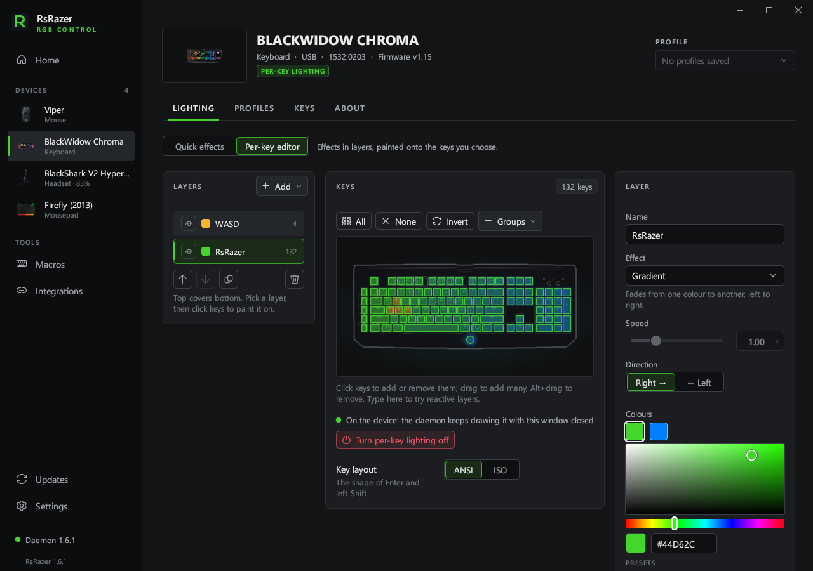

# RsRazer

[简体中文](README.zh-CN.md) · English

Control Razer devices on Windows 10 / 11 with a native Rust application and background service.

No Synapse, custom kernel driver or Python runtime is required.

[](https://github.com/imacte/RsRazer/actions/workflows/ci.yml)
[](LICENSE)



## Download

Download **[rsrazer-setup.exe](https://github.com/imacte/RsRazer/releases/latest/download/rsrazer-setup.exe)** from [Releases](https://github.com/imacte/RsRazer/releases).
It contains the application, native daemon and 32/64-bit Chroma SDK DLLs.
The installer works per user and supports repair and removal.
The installer includes English, Simplified Chinese and Russian.

The tray and UI run in separate processes. Closing the window saves the current page and editor drafts,
then exits the UI process to release its memory. Device communication, automatic profiles and update
downloads continue in the tray; click its icon to reopen the window.

| File | Purpose |
|---|---|
| `rsrazer-setup.exe` | Complete installer; the recommended download |
| `rsrazer.exe` | Main application; needs `rsrazer-daemon.exe` beside it when used without the installer |
| `rsrazer-daemon.exe` | Native background service and command line |
| `rsrazer-classic.exe` | Classic control panel with the daemon embedded |

Native release builds include the C runtime. Close Synapse before controlling the same devices.
Settings, profiles, macros and logs are stored in `%LOCALAPPDATA%\rsrazer`.
RsRazer does not automatically read or migrate data from `%LOCALAPPDATA%\openrazer-win`.

## Features

- A database of 279 product IDs, with USB HID and supported Bluetooth LE devices.
- Hardware lighting and software effects, per-key layers, audio-reactive lighting and profiles.
- DPI, polling rate, brightness and supported headset controls.
- Macro keys, key bindings and application-specific profiles.
- Windows accent colour and Chroma integrations.
- A local authenticated JSON-RPC interface and scriptable native CLI.

Available controls depend on the device. Database coverage does not mean every model has been tested on physical hardware.
The [device list](docs/devices.json) and `rsrazer-daemon supported` show bundled models.

## Command line

```powershell
rsrazer-daemon daemon start
rsrazer-daemon list
rsrazer-daemon info
rsrazer-daemon effect static red
rsrazer-daemon brightness 60
rsrazer-daemon dpi 1800
rsrazer-daemon keyswitch gaming         # Huntsman V2 / V2 Tenkeyless
rsrazer-daemon snaptap                  # Status, off by default
rsrazer-daemon snaptap pair add W S
rsrazer-daemon profile save night
rsrazer-daemon profile load night
rsrazer-daemon integration accent on
rsrazer-daemon rpc daemon.version
rsrazer-daemon doctor
```

Use `--help` for commands and options. `--device` selects a serial, product ID or name fragment;
`--json` prints machine-readable results. `daemon start --emulate` uses simulated devices and separate demo data.

Snap Tap runs in the daemon and applies to every keyboard. Enable it from the
keyboard Performance page after reading the warning, or use `snaptap on --accept`.
Some games prohibit software input changes; `cs2.exe` is excluded by default.
Use `snaptap deny add game.exe` or `snaptap allow add game.exe` to edit the lists,
and `snaptap off` to disable it. Exiting the daemon stops Snap Tap. Keyswitch
optimization is a keyboard firmware setting and remains in effect without it.

## Build from source

Install the pinned Rust toolchain and Microsoft C++ Build Tools with the Windows SDK, then run:

```powershell
git clone git@github.com:imacte/RsRazer.git
cd RsRazer
./studio/tools/build-native.ps1 -IncludeClassic
```

The installer and executables are written to `dist/`. No Python or PyInstaller step is used.

```powershell
cd studio
cargo clippy --workspace --all-targets --locked -- -D warnings
cargo test --workspace --locked
cargo run --locked -p rsrazer-tools -- check-translations
cargo run --locked -p rsrazer-tools -- docs-data --check
```

See [CONTRIBUTING.md](CONTRIBUTING.md) for development tools and [data/README.md](data/README.md) for database provenance.

| Directory | Contents |
|---|---|
| `studio/daemon` | Rust HID/BLE transports, protocols, effects, macros, RPC service and CLI |
| `studio/app` | Main graphical application |
| `studio/core` | Shared UI, translations, configuration and installer support |
| `studio/setup` | Installer with embedded application and daemon |
| `studio/chroma` | Native Chroma SDK DLL |
| `studio/tools` | Rust tools and PowerShell build/verification scripts |
| `gui` | Classic Rust control panel |
| `data` | Device, recipe and key data |

## Credits and feedback

RsRazer builds on [Ar4ikov/openrazer-win](https://github.com/Ar4ikov/openrazer-win)
and the device protocol work of [OpenRazer](https://github.com/openrazer/openrazer).
Upstream attribution and licence notices are retained. The legacy Python implementation is in Git history.

Report bugs or request devices in [Issues](https://github.com/imacte/RsRazer/issues).
For security reports, see [SECURITY.md](SECURITY.md). Licensed under [GPL-2.0-or-later](LICENSE).
