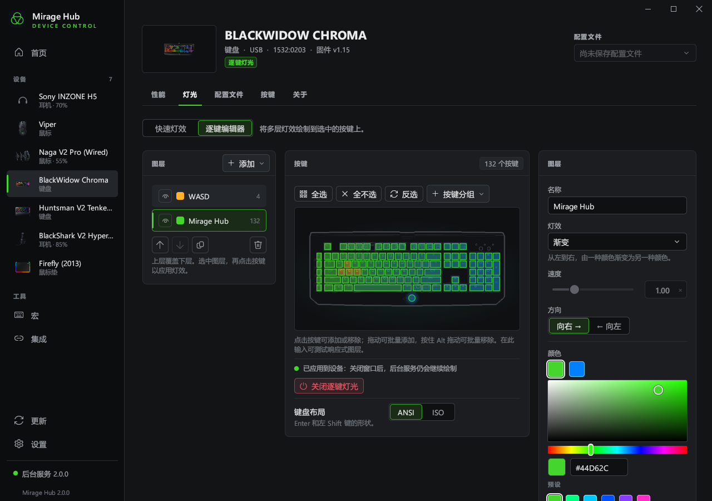
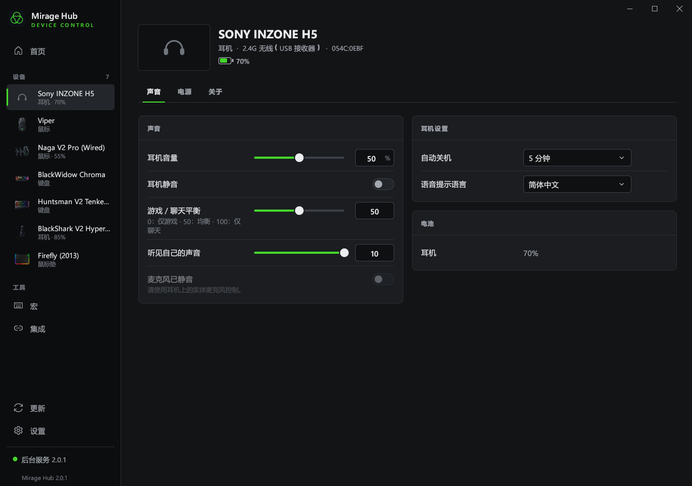

# Mirage Hub

简体中文 · [English](README.md)

用于 Windows 10 / 11 的 Razer 外设与 Sony INZONE 耳机控制工具，界面、后台服务和命令行均使用 Rust。
无需 Synapse、自定义内核驱动或 Python 运行环境。

[](https://github.com/imacte/MirageHub/actions/workflows/ci.yml)
[](LICENSE)



## 下载与安装

下载 **[mirage-hub-setup.exe 完整安装包](https://github.com/imacte/MirageHub/releases/latest/download/mirage-hub-setup.exe)**，或前往 [Releases](https://github.com/imacte/MirageHub/releases) 查看所有文件。
安装包已包含主程序、Rust 后台和 32/64 位 Chroma SDK DLL，不需要另外下载后台。

按当前用户安装，支持修复和卸载。
安装包内置简体中文、英语和俄语。

托盘和界面独立运行：关闭窗口会保存当前页面与编辑草稿，并结束界面进程、释放其内存。
托盘继续处理设备通信、按应用切换配置和更新下载；点击托盘图标即可重新打开界面。

| 文件 | 用途 |
|---|---|
| `mirage-hub-setup.exe` | 完整安装包，通常下载这一个即可 |
| `mirage-hub.exe` | 主程序；单独使用时，需要将 `mirage-hub-daemon.exe` 放在同一目录 |
| `mirage-hub-daemon.exe` | Rust 后台服务和命令行工具 |
| `mirage-hub-classic.exe` | 内嵌后台的经典控制面板 |

发布版静态链接 C 运行库。控制设备前请先关闭 Synapse，避免两个程序同时修改设置。
设置、灯效配置、宏和日志保存在独立的 `%LOCALAPPDATA%\mirage-hub` 目录中，
不会自动读取或迁移 `%LOCALAPPDATA%\openrazer-win` 中的旧数据。

## Sony INZONE 耳机

本项目原名 RsRazer，现改名为 Mirage Hub，并接入 [OpenInzone](https://github.com/penguinwokrs/openinzone) 的耳机控制协议。H5（`054C:0EBF`）与 Buds（`054C:0EC2`）通过 HID 控制；H9/H7（`054C:0E53`）通过独占 USB 串口控制。H9 II 等接收器使用耳机返回的型号信息识别。H5 的音量、游戏/聊天平衡、侧音与自动关机计时已通过实机验证；上游已验证 Buds、H9 和 H9 II，其他型号仍需实机验证。详见 [INZONE 支持与验证记录](docs/INZONE.md)。

- 耳机音量、静音、游戏/聊天平衡、侧音与电量；平衡 0 为仅游戏，100 为仅聊天。
- 调节对应耳机的 Windows 麦克风音量；仅 Buds 支持通过电脑切换耳机的麦克风静音，其他型号显示实体麦克风控制状态。
- 根据设备能力显示降噪、环境声、人声增强、自动关机与语音提示。H5 不支持的降噪功能不会显示。
- Buds 分别显示左右耳和充电盒电量；充电盒是上次由耳机传回的读数，未知值不显示成 0%。
- H5 的 48 kHz Game 输出支持 Sony APO 十段均衡器和标准空间音效。可选组件直接从 Sony 官方下载并校验，不随安装包分发。调整前请退出 INZONE Hub；全新系统的独立驱动安装仍属实验功能，详见 [Sony 音效说明](docs/INZONE.md#sony-apo-audio-effects-h5)。
- H9/H7 的串口不能共享，使用前需退出 INZONE Hub。暂不包含固件升级和 Stream Deck 插件。



```powershell
mirage-hub-daemon --device "INZONE H5" headset
mirage-hub-daemon --device "INZONE H5" headset volume 15
mirage-hub-daemon --device "INZONE H5" headset balance 50
mirage-hub-daemon --device "INZONE H5" headset sidetone 5
```

## 从 RsRazer 升级

首次升级请手动运行 `mirage-hub-setup.exe`；旧版更新器将下载地址限制在原仓库。安装程序会识别旧安装并替换程序入口。配置、宏、语言与应用关联会从 `%LOCALAPPDATA%\rsrazer` 一次性复制到 `%LOCALAPPDATA%\mirage-hub`，保留原文件，也不会覆盖已有 Mirage Hub 设置。不迁移后台端点、认证令牌和旧安装包缓存。使用便携版时，请先退出旧 RsRazer。

## 功能

- 支持 279 个 Razer 产品 ID 和 10 个 Sony INZONE 接收器 ID，包含 HID、INZONE 串口与部分 Razer 蓝牙 LE 设备。
- 硬件灯效、软件灯效、逐键图层、音乐响应和灯光配置。
- DPI、轮询率、亮度及设备支持的耳机设置。
- 宏按键、键位绑定和按应用切换配置。
- Windows 强调色同步和 Chroma 集成。
- 本机带令牌验证的 JSON-RPC 接口，以及可用于脚本的原生命令行。

具体功能取决于型号。数据库收录不代表每款设备都经过实机测试。
可在[设备列表](docs/devices.json)或 `mirage-hub-daemon supported` 中查看型号。

## 命令行

```powershell
mirage-hub-daemon daemon start
mirage-hub-daemon list
mirage-hub-daemon info
mirage-hub-daemon effect static red
mirage-hub-daemon brightness 60
mirage-hub-daemon dpi 1800
mirage-hub-daemon keyswitch typing
mirage-hub-daemon snaptap status
mirage-hub-daemon profile save night
mirage-hub-daemon profile load night
mirage-hub-daemon profile create work
mirage-hub-daemon profile create gaming --source work
mirage-hub-daemon integration accent on
mirage-hub-daemon rpc daemon.version
mirage-hub-daemon doctor
```

使用 `--help` 查看命令及选项。`--device` 可按序列号、产品 ID 或名称片段选择设备，
`--json` 输出便于脚本处理的结果。`daemon start --emulate` 使用模拟设备和独立的演示配置目录。

## 配置文件

保存、新建或加载配置后，该配置会成为设备的当前配置，之后的修改会自动保存。
切换时恢复灯光、键轴模式、DPI 档位、DPI 和回报率；键盘配置还保存 Snap Tap 的
开关和按键对。Snap Tap 的首次确认和程序排除列表属于全局设置，不会随配置导入。
`profile create 名称` 从默认设置开始，添加 `--source 原配置` 可创建副本。
命令行用 `*` 标记当前配置。这些配置保存在电脑上。

键轴优化适用于 Huntsman V2／V2 Tenkeyless，是设备固件设置。软件 Snap Tap 可在键盘
性能页确认提示后启用，需要后台服务持续运行，默认关闭并排除 `cs2.exe`。

Naga V2 Pro 的有线 `1532:00A7` 和接收器 `1532:00A8` 型号提供“板载存储”页面，
可将鼠标按键、键盘按键和宏保存到鼠标。位置 1 当前生效且断电保留；位置 2–5
存放其他映射。这些设置与电脑配置文件独立。命令行示例：

```powershell
mirage-hub-daemon onboard --device 00a7
mirage-hub-daemon onboard action 0x50 --device 00a7
mirage-hub-daemon onboard key 0x50 A --device 00a7
mirage-hub-daemon onboard macro-add 7 "down A; wait 50; up A" --device 00a7
mirage-hub-daemon onboard macro-bind 0x50 7 --device 00a7
```

请用 `list` 显示的产品 ID 或序列号选择当前设备。`--store 1..5` 选择存储位置，
`--layer 0..1` 选择标准／Hypershift 层，`--while-held` 设置按住时重复宏。
删除宏前会检查所有位置和两层按键，仍有绑定时拒绝删除。固件可能漏报宏编号，
可用 `onboard macro-length 编号` 检查；上传不会覆盖已有编号。
当前移植通过模拟设备和协议测试，实机验证记录见[上游 #2962](https://github.com/openrazer/openrazer/pull/2962)。

## 从源码构建

安装仓库指定的 Rust 工具链，以及包含 Windows SDK 的 Microsoft C++ Build Tools，然后运行：

```powershell
git clone git@github.com:imacte/MirageHub.git
cd MirageHub
./studio/tools/build-native.ps1 -IncludeClassic
```

完整安装包及各程序输出到 `dist/`。构建过程不需要 Python 或 PyInstaller。

```powershell
cd studio
cargo clippy --workspace --all-targets --locked -- -D warnings
cargo test --workspace --locked
cargo run --locked -p mirage-hub-tools -- check-translations
cargo run --locked -p mirage-hub-tools -- docs-data --check
```

开发说明见 [CONTRIBUTING.md](CONTRIBUTING.md)，设备数据来源见 [data/README.md](data/README.md)。

| 目录 | 内容 |
|---|---|
| `studio/daemon` | Rust HID/BLE 通信、协议、灯效、宏、RPC 服务和 CLI |
| `studio/app` | 主图形界面 |
| `studio/core` | 共用界面、翻译、配置和安装支持 |
| `studio/setup` | 内嵌主程序及后台的安装器 |
| `studio/chroma` | 原生 Chroma SDK DLL |
| `studio/tools` | Rust 开发工具及 PowerShell 构建、验证脚本 |
| `gui` | Rust 经典控制面板 |
| `data` | 设备、指令配方和按键数据 |

## 致谢与反馈

Mirage Hub 基于 [Ar4ikov/openrazer-win](https://github.com/Ar4ikov/openrazer-win)，
设备协议知识来自 [OpenRazer](https://github.com/openrazer/openrazer) 和 [OpenInzone](https://github.com/penguinwokrs/openinzone)。详见[第三方声明](THIRD-PARTY-NOTICES.md)。
旧 Python 实现可在 Git 历史中查看。

问题和设备支持请求请提交到 [Issues](https://github.com/imacte/MirageHub/issues)。
安全问题见 [SECURITY.md](SECURITY.md)。本项目采用 [GPL-3.0-only](LICENSE) 许可证。
