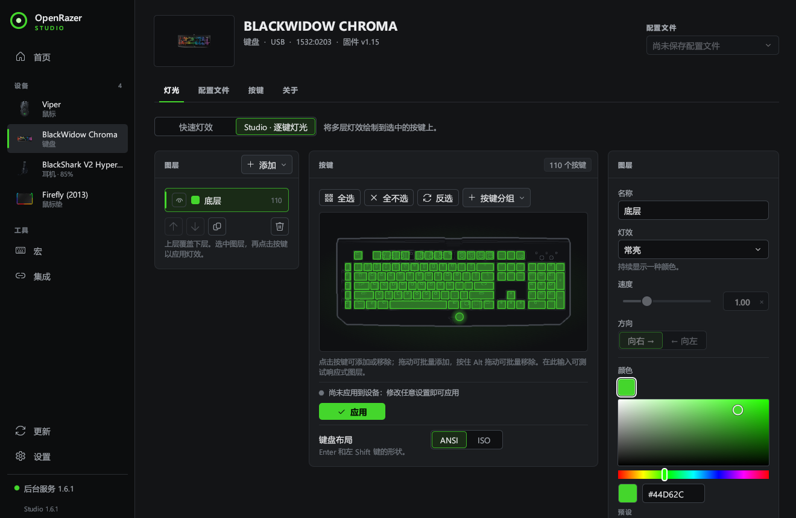

# OpenRazer for Windows · 简体中文

[English](README.md) · 简体中文

在 Windows 10 / 11 上控制 Razer 键盘、鼠标、鼠标垫和受支持的耳机，无需 Razer Synapse、内核驱动或 Razer 账户。

本分支为 **OpenRazer Studio 及其安装器**加入简体中文，保留英文和俄文。覆盖首页、设备、灯光、宏、集成、更新、设置、系统托盘，以及安装、修复和卸载流程。经典控制面板 `gui/`、旧版 Tk 界面和 Python 命令行暂未汉化；设备型号、协议标识、命令和 API 保持原样。



## 切换中文

- 简体中文 Windows（中国大陆或新加坡）首次启动时会自动使用简体中文。
- 其他系统，或已保存过语言偏好的用户：打开 **Settings → Language → 简体中文**。切换立即生效，托盘菜单同步更新，选择会在下次启动时保留。
- 选择 **设置 → 语言 → 跟随 Windows** 可恢复跟随系统。
- 安装器读取 Studio 保存的语言偏好；首次安装时跟随系统语言。

程序从 Windows 字体目录加载微软雅黑，并以黑体、宋体作为后备，使中文在标题、正文和输入框中正常显示。如果精简版系统删除了这些字体，需要恢复 Windows 简体中文字体。

更新页面优先显示发布说明中的中文内容，没有中文说明时回退到英文。在线更新来自上游项目，上游安装包可能尚未包含本分支的汉化；使用本地汉化构建时，可在设置中关闭自动检查更新，避免安装上游版本后恢复为英文/俄文。

## 功能

- **首页**：查看连接的设备，快速调整灯效、颜色、亮度、DPI 档位和游戏模式，统一关闭或恢复灯光。
- **设备**：调整灵敏度、DPI 档位、轮询率、休眠时间和低电量提醒；受支持的耳机还可以设置均衡器、侧音等。
- **灯光**：按区域选择常亮、呼吸、光谱循环、波浪、响应、涟漪等灯效；Studio 模式支持逐键灯光和图层编辑。
- **配置文件**：每台设备最多保存十个灯光配置，也可关联应用，在该应用位于前台时自动切换。
- **宏**：录制或编辑按键、等待、文本输入和打开程序等步骤，再分配到支持的宏按键。
- **集成**：音乐律动、Windows 主题色，以及 Razer Chroma 游戏灯光联动。
- **维护**：查看后台服务状态，保存诊断报告，修复安装或卸载程序。

使用前请关闭 Razer Synapse，以免两个程序同时修改设备设置。带反作弊系统的游戏不宜添加 Chroma DLL；使用新版 Razer SDK 并验证官方签名的游戏也可能无法联动。具体设备能力以程序显示为准。

## 从源码运行汉化版

需要 Python 3.9 或更高版本、Rust，以及 Visual Studio 的 C++ 构建工具和 Windows SDK。Rust 版本由 `studio/rust-toolchain.toml` 指定。

```powershell
git clone https://github.com/imacte/openrazer-win.git
cd openrazer-win
# 请使用包含汉化改动的分支或提交；本地开发分支为 feat/zh-cn-localization。
python -m pip install -e .

cd studio
cargo run --locked -p openrazer-studio
```

Studio 会尝试自动启动已安装的后台服务。也可以先在另一个终端运行：

```powershell
openrazer-win daemon start
```

构建可执行文件：

```powershell
cd studio
cargo build --release --locked -p openrazer-studio
```

输出为 `studio/target/release/openrazer-studio.exe`。单独构建此程序不包含 Python 后台服务或 Chroma DLL；开发环境可使用上面安装的 Python 后台服务。完整安装包的构建流程见 [.github/workflows/release.yml](.github/workflows/release.yml)。上游发布页的安装包不会自动包含本分支尚未发布的汉化改动。

## 命令行常用操作

命令保持英文，便于继续使用现有脚本：

```powershell
openrazer-win list                       # 列出已连接设备
openrazer-win info                       # 查看设备详情
openrazer-win effect static red          # 红色常亮
openrazer-win effect spectrum            # 光谱循环
openrazer-win brightness 60              # 亮度 60%
openrazer-win dpi 1800                   # 鼠标 DPI
openrazer-win poll-rate 1000              # 轮询率
openrazer-win battery                    # 电池状态
openrazer-win profile save night         # 保存配置
openrazer-win profile load night         # 应用配置
openrazer-win doctor                     # 诊断设备连接问题
```

蓝牙设备需要额外安装：

```powershell
python -m pip install "openrazer-win[ble]"
```

## 翻译维护与检查

简体中文词条位于 [`studio/core/src/zh_cn.rs`](studio/core/src/zh_cn.rs)，以界面英文原文为键。`{}` 占位符的数量和顺序必须与原文一致。新增界面文字时，请同时维护俄文和简体中文表。

```powershell
cd studio
python tools/check_translations.py
cargo clippy --workspace --all-targets --locked -- -D warnings
cargo test --workspace --locked
```

检查覆盖缺失及过期词条、重复键、占位符、语言偏好保存、系统语言识别、中文日期和发布说明的语言回退。

项目采用 [GPL-2.0-or-later](LICENSE) 许可证。原始项目为 [Ar4ikov/openrazer-win](https://github.com/Ar4ikov/openrazer-win)，基于 [OpenRazer](https://github.com/openrazer/openrazer) 的工作。Razer、Chroma 和 Synapse 的商标归其各自权利人所有，本项目与 Razer Inc. 无关联。
