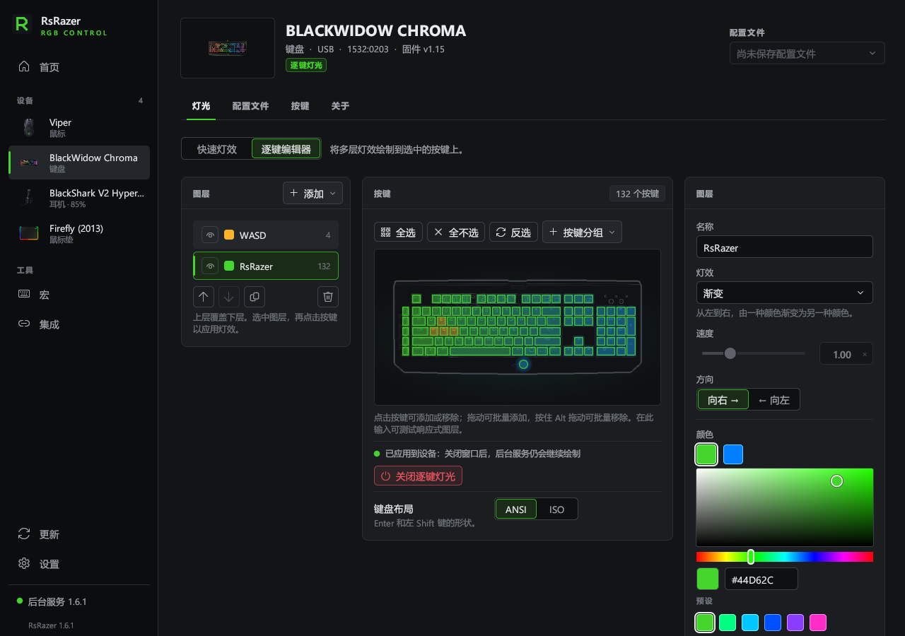

# RsRazer

简体中文 · [English](README.md)

用于 Windows 10 / 11 的雷蛇设备控制工具，界面、后台服务和命令行均使用 Rust。
无需 Synapse、自定义内核驱动或 Python 运行环境。

[](https://github.com/imacte/RsRazer/actions/workflows/ci.yml)
[](LICENSE)



## 下载与安装

在 [Releases](https://github.com/imacte/RsRazer/releases) 发布后，下载 **`rsrazer-setup.exe`**。
安装包已包含主程序、Rust 后台和 32/64 位 Chroma SDK DLL，不需要另外下载后台。
按当前用户安装，支持修复和卸载。
`rsrazer-setup-zh-CN.exe` 与它是同一个多语言安装包，内置简体中文、英语和俄语。

| 文件 | 用途 |
|---|---|
| `rsrazer-setup.exe` | 完整安装包，通常下载这一个即可 |
| `rsrazer.exe` | 主程序；单独使用时，需要将 `rsrazer-daemon.exe` 放在同一目录 |
| `rsrazer-daemon.exe` | Rust 后台服务和命令行工具 |
| `rsrazer-classic.exe` | 内嵌后台的经典控制面板 |

发布版静态链接 C 运行库。控制设备前请先关闭 Synapse，避免两个程序同时修改设置。
旧版灯效、配置和宏仍然兼容；数据目录保留为 `%LOCALAPPDATA%\openrazer-win`，以便读取已有设置。

## 功能

- 数据库包含 279 个产品 ID，支持 USB HID 和部分蓝牙 LE 设备。
- 硬件灯效、软件灯效、逐键图层、音乐响应和灯光配置。
- DPI、轮询率、亮度及设备支持的耳机设置。
- 宏按键、键位绑定和按应用切换配置。
- Windows 强调色同步和 Chroma 集成。
- 本机带令牌验证的 JSON-RPC 接口，以及可用于脚本的原生命令行。

具体功能取决于型号。数据库收录不代表每款设备都经过实机测试。
可在[设备列表](docs/devices.json)或 `rsrazer-daemon supported` 中查看型号。

## 命令行

```powershell
rsrazer-daemon daemon start
rsrazer-daemon list
rsrazer-daemon info
rsrazer-daemon effect static red
rsrazer-daemon brightness 60
rsrazer-daemon dpi 1800
rsrazer-daemon profile save night
rsrazer-daemon profile load night
rsrazer-daemon integration accent on
rsrazer-daemon rpc daemon.version
rsrazer-daemon doctor
```

使用 `--help` 查看命令及选项。`--device` 可按序列号、产品 ID 或名称片段选择设备，
`--json` 输出便于脚本处理的结果。`daemon start --emulate` 使用模拟设备和独立的演示配置目录。

## 从源码构建

安装仓库指定的 Rust 工具链，以及包含 Windows SDK 的 Microsoft C++ Build Tools，然后运行：

```powershell
git clone git@github.com:imacte/RsRazer.git
cd RsRazer
./studio/tools/build-native.ps1 -IncludeClassic
```

完整安装包及各程序输出到 `dist/`。构建过程不需要 Python 或 PyInstaller。

```powershell
cd studio
cargo clippy --workspace --all-targets --locked -- -D warnings
cargo test --workspace --locked
cargo run --locked -p rsrazer-tools -- check-translations
cargo run --locked -p rsrazer-tools -- docs-data --check
```

开发说明见 [CONTRIBUTING.md](CONTRIBUTING.md)，设备数据来源见 [data/README.md](data/README.md)。

| 目录 | 内容 |
|---|---|
| `studio/daemon` | Rust HID/BLE 通信、协议、灯效、宏、RPC 服务和 CLI |
| `studio/app` | 主图形界面 |
| `studio/core` | 共用界面、翻译、配置和安装支持 |
| `studio/setup` | 内嵌主程序及后台的安装器 |
| `studio/chroma` | 原生 Chroma SDK DLL |
| `studio/tools` | Rust 开发工具及 PowerShell 构建、验证脚本 |
| `gui` | Rust 经典控制面板 |
| `data` | 设备、指令配方和按键数据 |

## 致谢与反馈

RsRazer 基于 [Ar4ikov/openrazer-win](https://github.com/Ar4ikov/openrazer-win)，
设备协议知识来自 [OpenRazer](https://github.com/openrazer/openrazer)。保留上游署名与许可证说明。
旧 Python 实现可在 Git 历史中查看。

问题和设备支持请求请提交到 [Issues](https://github.com/imacte/RsRazer/issues)。
安全问题见 [SECURITY.md](SECURITY.md)。本项目采用 [GPL-2.0-or-later](LICENSE) 许可证。
